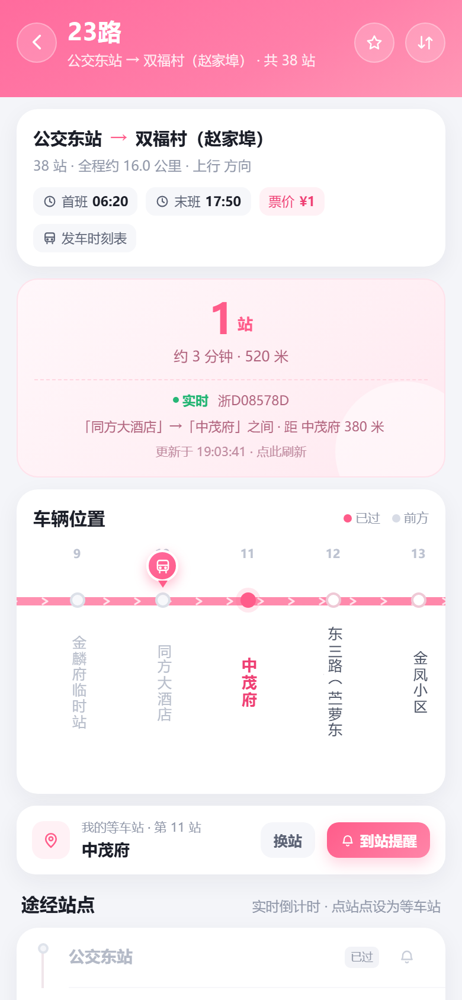
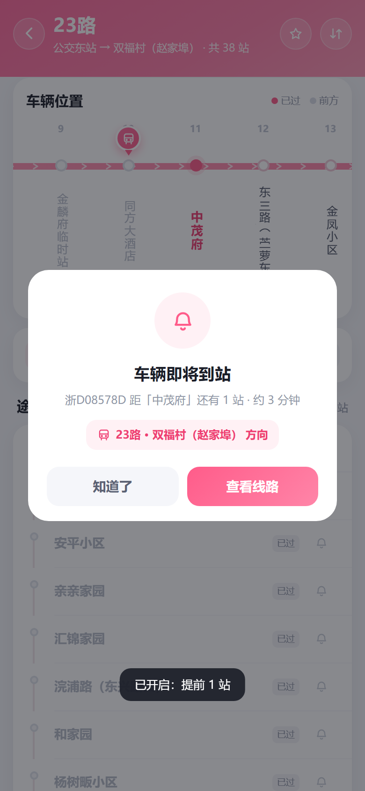
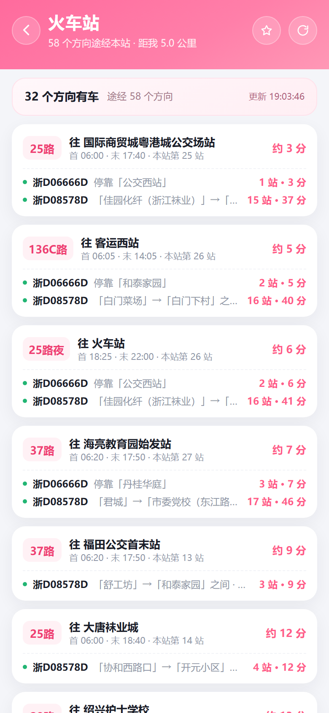
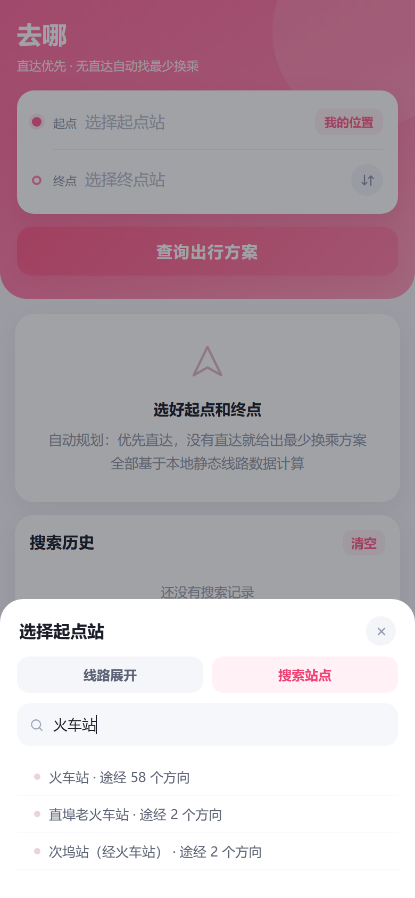

# 诸暨公交 · 轻量双 Tab 版

> 基于 [`byazlle/zhuji-bus-live`](https://github.com/byazlle/zhuji-bus-live) **v2.0.0（APK 1.1.1）** 二次开发的精简版：去掉地图 SDK、公告与「我的」，只保留 **首页 / 去哪** 两个标签，新增线路级实时车辆视图与**本地到站提醒**。

<p>


</p>

| 首页 | 线路实时 | 到站提醒 |
|---|---|---|
|  |  |  |

| 站点实时 | 换乘方案 | 站点选择 |
|---|---|---|
|  |  |  |

---

## 一、项目介绍

诸暨公交官方实时接口（`zjcx.zhuji.gov.cn`）免登录可用，但原版页面以「线路列表 + 站点序列」为主，缺少**车辆在线路上的位置**与**下车提醒**。本项目在 v2.0.0 的静态站点表与换乘算法基础上重做前端：

- **只做两件事**：看车（实时公交）、去哪（换乘查询）
- **两个 Tab**：首页、去哪；没有公告、没有「我的」
- **没有地图**：定位只用于计算附近站点，车辆位置用**横向线路时间轴**表达
- **本地提醒**：到站 / 下一站 / 提前两站，只在 App 内弹窗 + 震动，不做推送、不做后台驻留
- **静态兜底**：站点、线路、首末班、里程全部内置；实时接口不可用时自动降级为静态数据

APK 包名 `com.zhuji.bus.lite`，版本 `1.0.0`，最低 Android 5.1（API 22），目标 API 34。

---

## 二、功能清单

### 首页
- 线路号搜索：395 条线路实时过滤（输入 `23` 即命中 `23路`）
- 附近站点：定位后 Haversine 本地计算距离，按直线距离升序展示 5 个站点
- 我的收藏：收藏线路（胶囊）/ 收藏站点（列表），点击直达
- 到站提醒概览：显示「还有 2 站 · 约 4 分」或「已提醒 19:03」，可管理
- 全部线路：按号段排序，支持「加载更多」；行内星标一键收藏

### 线路实时页（核心新增）
- 顶部粉色渐变头：线路名、起终点、站数、收藏、**换向**
- 信息卡：首末班、票价（接口返回时展示）、发车时刻表入口
- 数据卡：最近一辆车距**我的等车站**的 `剩余站数 / 预计分钟 / 剩余距离`、车牌、实时标记、车辆当前位置文案（如「同方大酒店 → 中茂府 之间 · 距 中茂府 380 米」）
- 横向线路时间轴：站序编号 + 竖排站名 + 已过/前方站点区分 + **车辆图标**按 GPS 位置落点；可横向滑动，自动居中到等车站
- 途经站点列表：每站实时倒计时、剩余站数标签、已过标记，点击即设为等车站，行内铃铛直接加提醒
- 上下行切换、20 秒自动刷新、失败重试、收班时段提示
- 发车时刻表：官方全日班次，未发出的班次粉色高亮

### 到站提醒（本地，无推送）
- 三种粒度：**到站提醒**（剩 0 站）、**下一站提醒**（剩 1 站）、**提前 2 站**
- 触发方式：App 内弹窗 + `navigator.vibrate` 震动（Android 需 `VIBRATE` 权限）
- 触发内容：车牌、站名、剩余站数/分钟、线路方向；可「知道了」或「查看线路」
- 提醒依赖实时接口：接口中断时状态显示「数据中断 / 暂停」，不会误报
- 最多同时 10 条，可单条删除或一键清空；完成 2 小时后自动清理
- **明确不做**：系统推送、后台服务、云端订阅

### 去哪（换乘）
- 统一站点选择组件：
  - 方式 A：线路展开（按线路号定位 → 展开上下行 → 点站）
  - 方式 B：站名中文模糊搜索（输入非数字会自动切换）
- 起点支持「我的位置」→ 附近站点列表（直线距离）
- 起终点交换、查询即规划
- 算法顺序：**直达 → 1 次换乘 → 2 次换乘**，按「换乘次数 → 总耗时」排序，最多 6 个方案
- 方案卡：预计到达时间、乘车分钟、换乘预留 5 分钟、逐段线路与上下车站
- 搜索历史：最近 20 条，单条删除、一键清空、点击重查
- 免责：耗时按静态里程与平均速度估算，不含步行与等车

### 明确不做（需求外功能已剔除）
乘车码 · 消息推送 · 云端到站订阅 · 意见反馈 · 登录注册 · 地图渲染 · 地图 SDK 路径规划 · 公告 Tab · 我的 Tab · 车辆实时地图打点

---

## 三、技术栈

| 层 | 方案 |
|---|---|
| 前端 | 原生 HTML / CSS / ES6，无框架、无打包器，5 个 JS 模块 |
| 数据 | 内置 `www/data/snapshot.js`（395 线路 / 3061 站点 / 22186 条站序），实时数据走官方接口 |
| 定位 | `navigator.geolocation` + Haversine 距离，不接地图 SDK |
| 本地存储 | `localStorage`（收藏 / 历史 / 提醒），WebView 内持久化 |
| 安卓壳 | Capacitor 6 + Gradle 8.2.1，`MainActivity` 仅申请定位权限 |
| 测试 | puppeteer-core + 本地 Chrome，移动端 390×844 视口，105 项断言 |

### 目录结构

```
zhuji-bus-lite/
├─ www/                     # 纯静态站点（可直接部署）
│  ├─ index.html            # 两 Tab 骨架 + 四个全屏页
│  ├─ css/app.css           # 粉色浅色主题
│  ├─ js/
│  │  ├─ core.js            # 工具、静态数据索引、收藏、弹层
│  │  ├─ api.js             # 官方接口封装 + 实时数据加工（RT）
│  │  ├─ reminder.js        # 到站提醒引擎（轮询、弹窗、震动）
│  │  ├─ picker.js          # 统一站点选择组件
│  │  ├─ line.js            # 线路实时页（时间轴、车辆、时刻表）
│  │  ├─ station.js         # 站点实时页
│  │  ├─ go.js              # 换乘规划 + 历史
│  │  ├─ home.js            # 首页
│  │  └─ app.js             # Tab 路由、定位、启动
│  └─ data/snapshot.js      # 静态数据快照（由脚本生成）
├─ android/                 # Capacitor 安卓工程
├─ scripts/
│  ├─ extract-data.py       # 从 v2.0.0 基线提取静态数据
│  ├─ make_icons.py         # 生成图标与启动图（纯标准库）
│  └─ shot.mjs              # 界面截图脚本（开发辅助）
├─ tests/e2e/app-test.mjs   # 105 项 E2E 测试
├─ docs/自测报告.md
└─ README.md
```

---

## 四、快速开始（网页）

```bash
# 任意静态服务器即可，不能直接 file:// 打开（XHR 与模块加载）
python -m http.server 8899 --directory www
# 打开 http://127.0.0.1:8899
```

可选参数：

- `?mode=static`：强制静态模式（不请求实时接口，用于演示/离线）
- 默认 `api` 模式：实时接口失败时**自动**降级为静态站点数据

---

## 五、数据说明

### 5.1 静态数据（兜底，随包内置）

`www/data/snapshot.js` 由 `scripts/extract-data.py` 从 v2.0.0 基线生成，结构：

```js
window.SNAPSHOT = {
  v: 2,
  generated: "2026-11-18",
  names: ["西施殿公交首末站", "西施殿", ...],       // 站点名池，下标即站名 ID
  lines: [{
    n: "23路",
    d: [{
      k: "up", id: "3306812312",                    // 方向线路 ID（实时接口用）
      f: "06:20", l: "17:50",                       // 首末班
      s: [[12, 480, 2971360, 12023620], ...]        // [站名ID, 到下一站米数, 纬度×1e5, 经度×1e5]
    }]
  }]
}
```

运行时索引（`core.js`）会展开为：线路名 → 方向 → 有序站点（含累计里程）、站点名 → 途经方向列表。换乘、耗时、附近站点全部基于这份数据在本地计算。

> 坐标已在基线中转换为 GCJ-02，与官方接口一致；距离使用 Haversine 球面公式（米）。

### 5.2 实时数据（预留接口）

基础地址 `https://zjcx.zhuji.gov.cn:9443`，POST JSON，固定请求头（见 `www/js/core.js` 的 `CFG.API_H`），返回 `code === "200"` 为成功。

| 用途 | 路径 | 关键参数 | 主要返回 |
|---|---|---|---|
| 线路详情 | `/gzcx-busServer/client/busLine/queryLine` | `lineId`（方向 ID） | `up.stationList`、`startFirst/startLast`、`totalPrice` |
| 实时车辆 | `/gzcx-busServer/client/bus/vehicle/dynamic/line/details` | `lineId` | `list[].vehicleOrder / distance / isArriveStation / plateNumber / gpsTime`、`busAverageSpeed` |
| 发车时刻表 | `/gzcx-busServer/client/busLine/getBusLinePlanSimpleTime` | `lineId` | `["06:20", ...]` |

**关键口径**（与官方接口一致，容易踩坑）：

- `vehicleOrder` = 车**已经驶离**的那一站（1 基），不是「下一站」
- `distance` = 到 `vehicleOrder + 1` 站的距离（米）
- 到某站的剩余站数 = `目标站序号 − vehicleOrder`；为 0 且 `isArriveStation !== 1` 视为刚离站
- 预计分钟 = `剩余米数 / busAverageSpeed + 剩余站数 × 0.35`（停靠折算）

替换后端只需实现同样三个方法：`ZJ.Api.lineDetail / vehicles / plan`（`www/js/api.js`）。

---

## 六、网页部署

### GitHub Pages

```bash
# 仓库已包含 gh-pages 分支时，直接访问：
#   https://<user>.github.io/<repo>/
git subtree push --prefix www origin gh-pages
```

或在仓库 **Settings → Pages** 选择分支 `gh-pages` / 根目录。

### 任意静态托管

把 `www/` 整个目录上传即可（Nginx、OSS、Vercel、Netlify 均可），无需 Node 服务端。

---

## 七、安卓打包教程

### 7.1 环境

| 依赖 | 版本 |
|---|---|
| JDK | 17（`JAVA_HOME`） |
| Android SDK | Platform 34 + Build-Tools 34.0.0（`ANDROID_HOME` 或 `android/local.properties`） |
| Gradle | 8.2.1（AGP 8.2.1，可用 wrapper 或本地安装） |
| Node.js | 18+（仅用于 Capacitor CLI） |

### 7.2 步骤

```bash
npm install                     # @capacitor/core、android、cli
npx cap sync android            # 把 www/ 同步到 android/app/src/main/assets/public
```

`android/local.properties`：

```properties
sdk.dir=/path/to/Android/Sdk
```

签名（`android/app/build.gradle` 已配置 `release`）：

```groovy
signingConfigs {
    release {
        storeFile file("../release.keystore")
        storePassword "******"
        keyAlias "zjbus"
        keyPassword "******"
    }
}
```

构建：

```bash
cd android
./gradlew assembleRelease
# 产物：android/app/build/outputs/apk/release/app-release.apk
```

首次打包请替换为自己的 keystore：

```bash
keytool -genkeypair -v -keystore release.keystore -alias zjbus \
  -keyalg RSA -keysize 2048 -validity 10950
```

### 7.3 安卓侧改动

- `AndroidManifest.xml`：`INTERNET`、`ACCESS_FINE_LOCATION`、`ACCESS_COARSE_LOCATION`、`VIBRATE`
- `MainActivity.java`：启动时申请定位权限、开启 WebView 的 `Geolocation / DOM Storage`
- 主题：状态栏 `#FF5C8A`、浅色导航栏；启动图为粉色渐变 + 巴士标志
- 包名 `com.zhuji.bus.lite`，`versionCode 1` / `versionName 1.0.0`

---

## 八、测试

```bash
python -m http.server 8899 --directory www     # 终端 1
node tests/e2e/app-test.mjs                    # 终端 2（需本地 Chrome）
```

- 结果：**105 项断言全部通过**，控制台 0 个 JS 错误
- 覆盖：静态数据加载、Tab 切换、定位与附近站点、线路搜索、线路实时页、上下行切换、收藏线路/站点、时刻表、到站提醒（含震动与弹窗）、站点实时页、换乘规划、历史记录、定位失败、网络异常降级、无结果空态、移动端横向溢出、禁用功能核查
- 详见 [docs/自测报告.md](docs/自测报告.md)

---

## 九、已知限制

1. 实时接口由诸暨公交官方提供，**收班后（约 18:00 后）多数线路无在线车辆**，页面会显示「已收班 / 此刻暂无在线车辆」并给出静态时刻表估算，不会编造数据。
2. 到站提醒只在 App **前台**生效（每 15 秒轮询），锁屏或退出后不再提醒；这是「不做推送」的必然结果。
3. 无地图 SDK，附近站点与换乘均为**直线距离/静态里程**估算，不含步行路径与实时路况。
4. 静态快照为 2026-11 的站点表，官方调整线路后需重新执行 `python scripts/extract-data.py`（来源为 v2.0.0 基线 `index.html`）。
5. 发车时刻表部分线路官方返回空数组，此时仅展示首末班。

---

## 十、致谢与免责

- 数据与站点表来源：[`byazlle/zhuji-bus-live`](https://github.com/byazlle/zhuji-bus-live)（v2.0.0 基线）
- 接口信息参考：[`fgh1995/zhujibus`](https://github.com/fgh1995/zhujibus)
- 本项目仅用于个人出行辅助，所有到站时间与换乘方案**仅供参考**，请以实际运营为准；请勿用于商业用途或高频抓取。

MIT License
